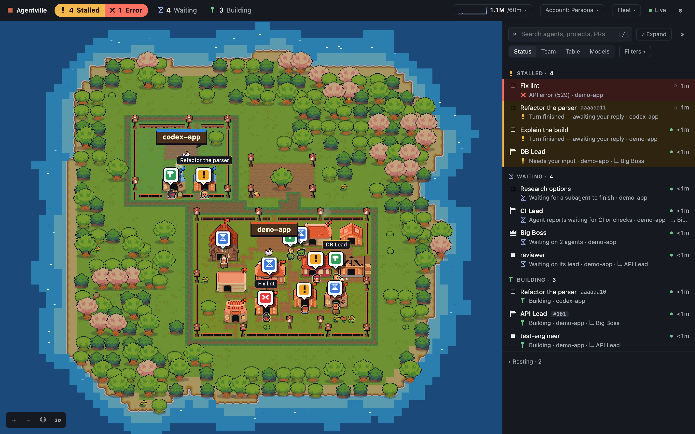
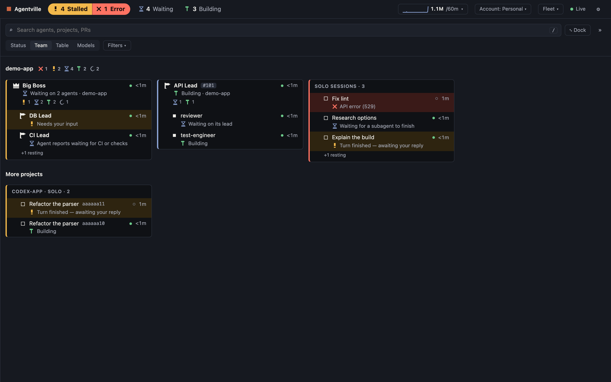
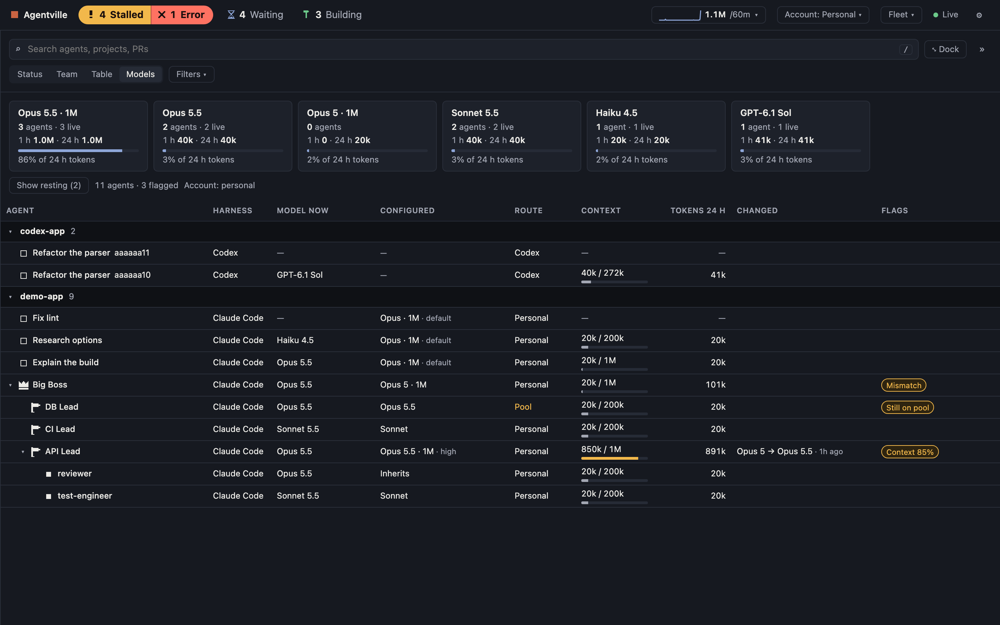
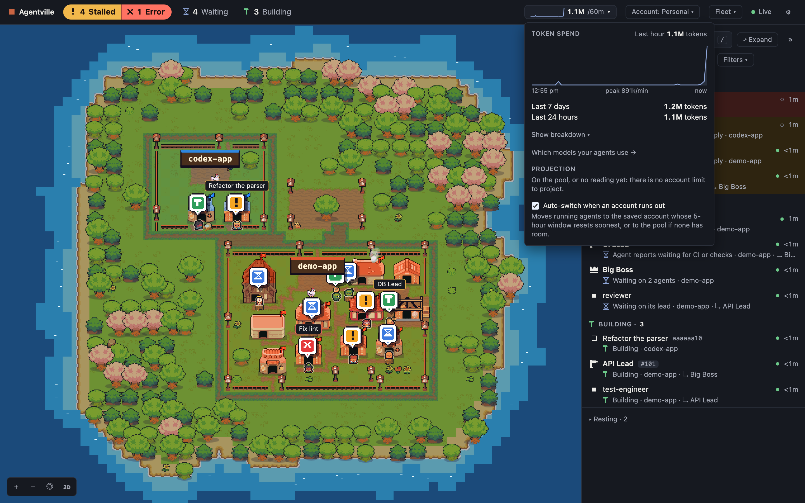

# Agentville

**Every Claude Code and Codex session on your machine, as a little pixel-art village.** See at a
glance who's building, who's waiting on something, and who needs you.



Agentville is a small local web app. It reads the session files Claude Code and Codex already write
to your disk and shows each agent as a villager, with a dark-mode list on the left of the village. There's
nothing to sign up for, and nothing leaves your machine except the usage and update checks described
under [Privacy & safety](#privacy--safety).

## What it does

**Three buckets.** Every agent that isn't resting is in exactly one:

| Bucket | Means | Examples |
| --- | --- | --- |
| **Stalled** (amber; red for errors) | It needs *you*. | Waiting for your reply; a permission prompt or a question to answer ("Needs a click", purple); an API error; a process that died mid-work; no progress for 30 minutes. |
| **Waiting** | It's blocked on something other than you. | CI or checks, a foreground subagent, a background job, its own child agents still working. |
| **Building** | It's actively working right now. | A live session mid-turn, a background job the scheduler reports active. |

Agents quiet for 24 hours, or that finished cleanly, are **resting**: tucked away by default but
searchable. The tab title shows how many are stalled, and Settings can turn on desktop
notifications. The exact rules are in [docs/ARCHITECTURE.md](docs/ARCHITECTURE.md#how-agents-are-sorted-into-buckets).

**Hierarchy.** If you run orchestrators, Agentville shows the structure: a **boss** with its
**leads**, and each lead with its **subagents** and teammates. It works this out from `claude --bg`
launches in transcripts, background-job records, subagent files and Codex spawn edges. You can
correct any agent's role, parent or name from its menu.

**The village.** Each project is a neighbourhood. Agents live in homes, subagents gather in their
lead's yard, and pull requests become buildings. Stalled villagers show a "!" bubble. There's day
and night, an isometric (2.5D) and a top-down view (**I** toggles), and buildings never move around
between visits. Click a villager to select its row, and the other way round.

**The agent menu.** Right-click an agent (in the village or the list), long-press it on a phone, or
use its **⋯** button: a header with its name, status and PRs, then **Open in terminal** (or **Open
in Ghostty**), **Show in village**, **Copy resume command**, **Fork…**, **Stop…**, **Mark
important**, **Edit…** (name, role and parent) and **Hide in village**. On the keyboard, the menu
key or Shift+F10 opens it on the focused row.

**Views.** The panel groups agents three ways (**V** cycles):

- **Team**: the boss → lead → sub tree. **Crowns** (the bosses and everyone under them) come first,
  then each project's teams and the solo agents. A project with nothing awake isn't listed (its
  Important agents keep it there); each team keeps its quiet members behind a "+N resting" line.
- **Tree**: the same hierarchy as an org chart. Crowned bosses sit at the top with their leads and
  workers below, grouped by project, and solo agents go in one group at the end. Resting teams fold
  into a "+N resting" pill, and each team folds on its own (**Expand all** and **Collapse to live**
  do this for everything). Drag or scroll to pan, and pinch or Cmd/Ctrl-scroll to zoom. Arrow keys
  move between a parent, its reports and their siblings. A search keeps each match's chain of
  command, shown dimmed. Narrow panels and phones get an indented outline instead. Only cards near
  the screen are drawn, so a thousand agents stay smooth.
- **Models**: which model each agent is *really* using (from its latest reply) next to what it was
  told to use, its route, context use and tokens, with flags for mismatches.

The first time you open Agentville, the panel fills the window in Team view. **⤡ Dock** (or **F**)
puts it on the left of the village; Agentville remembers your choice.





**Token spend.** The top bar shows tokens per minute and the last hour's total. Click it for a chart
of the past hour, 24-hour and 7-day totals, a breakdown by kind (input, output, cache writes, cache
reads; Codex in its own rows) and, while you're on a saved Claude account, a projection of when your
5-hour and weekly limits run out.



**Accounts and auto-switch** (optional, Claude Code only). Save more than one Claude login in the
**Account** menu, see each one's 5-hour and weekly usage, and move every running background job to
another account in one go. Every switch makes a backup first, tries the change on one job before the
rest, and rolls everything back if that fails; **Undo** restores the last backup. **Auto-switch** (on
by default; toggle it in the token-spend popover) moves you to an account with room when the current
one runs out. If you use a shared gateway or token pool (configured via `ANTHROPIC_BASE_URL` and
friends in `~/.claude/settings.json` → `env`), it appears as one more choice, the "pool". You can
also mark accounts **quarantine** so they're never used on your work Wi-Fi.
[Details](#accounts-in-detail).

**Fleet actions** (experimental). Message many agents at once: *Prep for laptop reboot*, *Prep for
internet loss* (each agent commits locally, writes a resume note and stops), *Resume*, and *Continue
errored agents*. You always confirm a preview that lists every recipient first.
[Details](#fleet-actions-experimental).

**Open in a terminal.** **Open** resumes an agent in a new terminal window: Ghostty if it's installed,
else Terminal.app on macOS; `$TERMINAL`, `gnome-terminal` or `x-terminal-emulator` on Linux.
**Open in terminal** runs the same command in a terminal inside the page, with the agent list kept on
the left so one click switches agents. The server picks the command itself
(`claude attach <job>`, `claude --resume <id>` or `codex resume <id>`); the page can't choose it. A
session that's already running somewhere else is never resumed a second time. The last few terminals
you opened stay live, so switching back shows one at once, as you left it. Cmd-C copies a selection,
Cmd-V pastes, Cmd-F finds, Cmd-K clears the view and Cmd-click opens a link; the wheel goes to the
program when it tracks the mouse (Claude Code's full-screen mode), as in any terminal.

## Quick start

```sh
git clone https://github.com/qin2500/agentville.git
cd agentville
./setup.sh      # checks Node, installs dependencies, builds the app; on macOS offers a Desktop launcher
npm start       # then open http://127.0.0.1:5275/
```

`./setup.sh` is safe to re-run. `--no-launcher` skips the launcher and `--launcher` makes it without
asking; `npm run setup` does the same. Stop the server with Ctrl-C.

## Desktop app

Prefer a window of its own to a browser tab? Agentville can run as a desktop app (Electron). It's a
thin shell around the same thing: it reuses a server already answering on the port, or runs
`node server/cli.mjs` from your checkout itself, then shows `http://127.0.0.1:5275/`. The page, its
keys, settings and data are exactly the browser's.

```sh
npm run app                      # try it straight from the checkout
npm run app:build                # build dist-app/…/Agentville.app (macOS; signed ad hoc)
npm run app:build -- --install   # …and copy it to ~/Applications (or --install <folder>)
npm run app:build -- --repo DIR  # run the checkout at DIR instead of this one
```

- **Updates reach it without a rebuild.** The app runs the server and page from your checkout, so
  **Update now** (or `git pull` + `./setup.sh`) updates it; after an in-app update the app restarts
  the server and reloads the window itself. Rebuild the app only when `desktop/` changes.
- **Which checkout:** the build bakes this folder's path into the app (`Resources/repo-path`). Moved
  it? Run `npm run app:build -- --install` again, or put `{"repo": "/path/to/agentville"}` in
  `~/Library/Application Support/Agentville/config.json`. `AGENTVILLE_DESKTOP_REPO` overrides both.
- **Port:** `AGENTVILLE_PORT`, else `"port"` in that `config.json`, else 5275.
- **Node:** your own Node 22.13+ (found like the launcher does: `~/.local/bin`, volta, fnm, nvm,
  Homebrew, `/usr/local/bin`, then `PATH`; `AGENTVILLE_DESKTOP_NODE` picks one), so the built-in
  terminal and updates behave as in browser mode. Without one it falls back to Electron's own Node.
- **Quit** stops a server the app started, never one it found running. Closing the window on macOS
  hides it (notifications keep coming); click the Dock icon to bring it back. Your agents are never touched.
- **Links** to anything but the local server (pull requests, docs) open in your default browser. The
  page gets no Node access (context isolation, sandbox, no preload); DevTools are under *View*.
- **Browser storage is the app's own,** so view choices you made in a browser tab (docked or full,
  village style) start from their defaults once. Settings the server keeps are shared.
- Logs: `~/Library/Application Support/Agentville/server.log` (a server the app started) and
  `app.log`. Window size and position are remembered there too.
- **Icon:** drawn in code by `tools/icon` (pixel art, no image assets): `npm run icon` redraws
  `desktop/icons/` (the app's `.icns` and PNGs) and the page's favicon, `web/public/icon-*.png`.

## Updates

Agentville checks GitHub for a newer version shortly after it starts and then every 6 hours. When
there is one, it asks you **once**: "Agentville update available", with the list of what changed,
**Update now** and **Later**. After Later it doesn't ask again for that version; a quiet **Update
available** item stays in the Settings (⚙) menu. A later version asks once more.

**Update now** runs `git pull --ff-only origin main`, `npm ci` if the dependencies changed, and
`npm run build`, then restarts Agentville and reloads the page. Your agents keep running; a built-in
terminal open in the page closes. If the pull fails, your copy is left as it was. It only offers the
button when that's safe: on the `main` branch, with no local edits to tracked files and no commits of
your own. Otherwise it says why and shows the commands to run yourself:

```sh
cd agentville
git pull origin main
./setup.sh      # then restart Agentville (Ctrl-C and npm start, or reopen the launcher)
```

The check needs a `git clone` of Agentville and `git` on your PATH; anywhere else it is quietly off.
To turn it off, set `AGENTVILLE_UPDATE_CHECK=0`. A fork checks its own `origin`.

## Requirements

- **Node.js 22.13 or newer** (`node --version`). Install it from [nodejs.org](https://nodejs.org),
  with `brew install node`, or with `nvm install 22`.
- **Claude Code and/or Codex**, used on this machine. Either one is enough. With neither, Agentville
  still starts and tells you where it looked.
- **macOS** gets everything. **Linux** runs the server, the village and every view. The Desktop
  launcher, Keychain-backed accounts and the work-Wi-Fi rule are macOS-only. On Linux, Claude's login
  is read from `~/.claude/.credentials.json`.
- Optional: the Xcode command line tools (`xcode-select --install`) to build the Desktop launcher, and
  [Ghostty](https://ghostty.org) 1.3+ if you'd rather **Open** used it than Terminal.app.

## How it works

The server (`server/`, plain Node, no framework) scans `~/.claude` and `~/.codex` every couple of
seconds while the page is open, reading only bounded pieces of each file. It turns what it finds into
one record per agent, sorts them into buckets and a hierarchy, and serves that to the web app (`web/`,
vanilla JS and Canvas, built with Vite) on `127.0.0.1:5275`. [docs/ARCHITECTURE.md](docs/ARCHITECTURE.md)
has the details.

## Privacy & safety

**What it reads:** Claude Code's folder (`~/.claude`: transcripts, background jobs, the live-session
registry, `settings.json`) and Codex's (`~/.codex`: its state database and rollouts). The UI shows
titles, first-prompt summaries, statuses and counts, never conversation text: no replies, tool
arguments, commands, outputs or file contents. The only other strings it shows are short ones Claude
Code writes for this purpose: a background job's `needs` line and its suggested reply. Token counts
come from local transcripts only. Changed files come from `git` in each agent's folder (paths and line
counts, never content), and PR state and CI checks from the cache Claude Code itself keeps
(`~/.claude/gh-pr-status-cache.json`); Agentville never asks GitHub.

**What it sends, and to whom:** only these calls. Usage checks go to Anthropic, about your own
Claude logins:

- While Claude Code is signed in to a Claude account (not a shared gateway), the server asks
  `api.anthropic.com` once a minute for that login's 5-hour and weekly usage and, when its tokens
  change, whose login it is. This drives the projection and auto-switch.
- When you open the Account menu, press Refresh, or switch accounts, it asks for your saved accounts'
  usage, and `platform.claude.com` renews an inactive saved account's login.

For these calls it reads Claude Code's login from the macOS Keychain (or
`~/.claude/.credentials.json`) and sends the token only to Anthropic. It also runs
`claude auth status` to see which kind of login is active.

The update check asks GitHub's public API (`api.github.com`) every 6 hours whether `main` has moved
on: one anonymous request whose only information is the commit your copy is on, in the URL (with the
generic user agent `agentville-update-check`). No login, no token, nothing about you or your agents.
`AGENTVILLE_UPDATE_CHECK=0` turns it off. **Update now** downloads from your checkout's `origin`
with `git` and installs packages with `npm`, only when you click it.

Nothing else goes anywhere: no analytics, no telemetry.

**The server is local-only.** It listens on `127.0.0.1` and refuses requests that don't come from
this machine, or that come from another web page.

**What it writes:** only its own folder, `~/.config/agentville/` (or `$XDG_CONFIG_HOME/agentville`):
your overrides, token-spend counts, settings, which agents are running (`restore.json`: ids, names,
folders, roles and times, for Restore after crash), logs of what it did (ids and results, never message
text or tokens) and, if you use the Account menu, your saved logins. Saved logins and their backups
are readable only by you (files `0600`, folders `0700`). Claude Code's own login stays where Claude
Code keeps it: the macOS Keychain (read and written with `security`, never on a command line) or
`~/.claude/.credentials.json` on Linux. Tokens never reach the page, an API response or a log.

**When it acts on your agents.** All but the last only happen when you click:

- **Open** and **Terminal** run the resume command the server chose for that agent.
- **Fleet** sends messages only after you confirm a preview listing every recipient.
- **Message agents** sends one message you wrote to the agents you picked (up to 50), after you confirm the exact text and recipients.
- **New agent**, **Stop job** and **Fork** run `claude --bg`, `claude stop` or
  `claude --resume --fork-session --bg`, after you confirm the exact command (see
  [Acting on one agent](#acting-on-one-agent)).
- **Restore after crash** runs `claude respawn` (or, if that fails, `claude --bg --resume`) for the
  crown and Important background jobs a reboot stopped, after you confirm the exact commands, then
  sends each restored crown agent one fixed message (see [Restore after crash](#restore-after-crash)).
- **Switch account** changes Claude Code's login (and, from the pool, its settings) and restarts
  running background jobs, with backups and automatic rollback.
- **Auto-switch** does that same switch by itself when an account runs out, and tells you, with
  Undo. Turn it off in the token-spend popover.
- **Update now** updates Agentville's own folder and restarts its server (see [Updates](#updates)).

Agentville used to be called Village AI. On first start it moves `~/.config/village-ai` to
`~/.config/agentville` (or, if it can't move it, copies it and leaves the old folder alone). Old
`VILLAGE_*` environment variables still work.

## Configuration

All optional.

| Variable | Default | What it does |
| --- | --- | --- |
| `AGENTVILLE_PORT` | `5275` | Port to serve on (1–65535). |
| `AGENTVILLE_DATA_DIR` | `$XDG_CONFIG_HOME/agentville`, else `~/.config/agentville` | Agentville's own files. |
| `AGENTVILLE_CLAUDE_HOME` | `$CLAUDE_CONFIG_DIR`, else `~/.claude` | Where to read Claude Code sessions. |
| `AGENTVILLE_CODEX_HOME` | `$CODEX_HOME`, else `~/.codex` | Where to read Codex sessions. |
| `AGENTVILLE_TERMINAL` | auto | Terminal for **Open** (a name or absolute path), with no fallback. |
| `AGENTVILLE_CREDENTIALS` | Keychain on macOS | `file` keeps Claude's login in `~/.claude/.credentials.json` instead. |
| `AGENTVILLE_FLEET_DRY_RUN` | off | `1`: fleet actions open no socket at all. |
| `AGENTVILLE_UPDATE_CHECK` | on | `0`: never check GitHub for updates. |
| `AGENTVILLE_UPDATE_REPO` | your `origin`, else `package.json` | The GitHub repository (`owner/repo`) to compare with. |

The tests use a few more (`AGENTVILLE_TEST`, `AGENTVILLE_FAKE_BIN` and others); see `e2e/helpers.mjs`.

## Troubleshooting

- **"Port 5275 is in use."** Something else, maybe another Agentville, is on that port. Stop it, or
  run `AGENTVILLE_PORT=5300 npm start`.
- **"Agentville needs Node.js 22.13 or newer."** Install a current Node (see Requirements), open a new
  terminal and run `./setup.sh` again. With nvm, run `nvm use 22` first.
- **No agents showing.** The list says which folders it looked in and whether they exist. Start a
  Claude Code or Codex session and it appears within a few seconds. If your Claude folder is somewhere
  else, set `CLAUDE_CONFIG_DIR` (or `AGENTVILLE_CLAUDE_HOME`). Resting agents are tucked away: search
  for them, or open the Resting section.
- **macOS won't open the launcher.** It's built and signed on your own Mac, so Gatekeeper rarely
  objects. If it does, right-click **Agentville.app** → **Open** → **Open**, or allow it under System
  Settings → Privacy & Security. Startup errors appear in a dialog, with details in
  `~/.config/agentville/launcher.log`. The app remembers where this folder is, so run
  `./setup.sh --launcher` again if you move it.
- **Open does nothing, or says it was "denied Automation access".** The first time, macOS asks whether
  your terminal (or node) may control Ghostty or Terminal. Allow it under System Settings → Privacy &
  Security → Automation.
- **"Build failed; serving the API only."** Run `npm ci && npm run build` to see the error.

## Accounts in detail

- **Saving accounts.** The login Claude Code has now shows as "Claude login"; **Save** keeps it.
  **Add account…** saves the current login, then opens a terminal running `claude auth login`. Sign in
  with the other account, choose **I've logged in**, and Agentville saves the new login and puts the
  previous one back, so adding an account never changes what's running.
- **Switching.** The current login is saved first, then the chosen one is written to Claude Code's
  login store. From the pool, the gateway settings move out of `settings.json` into
  `pool-profile.json` (put back exactly when you switch back), and jobs lose the gateway-only `cc/`
  model prefix. Each running background job is restarted with `claude respawn <id>`, one at a time.
  It keeps its conversation, but running subagents and background shells in the old process end.
  Sessions you started in a terminal are never restarted: Agentville lists them so you can restart
  them yourself.
- **Safety.** Backups go to `account-backups/` first. The first job is a test: if it doesn't come back
  running on the new settings, or its first reply is an API error, everything is put back. One change
  at a time, at most three a minute.
- **Auto-switch.** An account is out when its 5-hour or weekly window reaches 99 %, or when a running
  agent reports a usage limit. Agentville then switches to the saved account with room (both windows
  under 95 %) whose 5-hour window resets soonest, else to the pool. At most once every 15 minutes, and
  never from the pool back to an account.
- **Quarantine accounts and your work Wi-Fi.** Some accounts shouldn't be used on a work network. Mark
  them **Quarantine**, and while you're on your work Wi-Fi choose **This is the work Wi-Fi** once.
  Networks are recognised by the router's hardware address, a local lookup that needs no permission.
  On that network quarantine accounts are never used, and Agentville moves off one straight away.
  Anywhere else they're preferred when they have room. Being offline never counts as leaving.

## Acting on one agent

Everything here starts in an agent's menu (or, for a new agent, the **+ New agent** button in
the Team view's header). Each action has a confirm step that shows exactly what will happen: the
exact text that lands in the session, or the exact command and the folder it runs in. The confirmation
is good once, for 2 minutes. The page never supplies a command, a flag or a program: the server builds
it from fixed choices. Each action is logged to `fleet-log.jsonl` (ids and outcomes, never the text or
prompt), and at most 10 messages and 10 starts, stops or forks a minute are allowed.

- **New agent.** Pick a project (folders your agents have worked in), write a prompt, and optionally
  a name, model, effort, permission mode (bypassing permissions isn't offered) and a new git
  worktree. **Review…** shows the command, e.g. `claude --bg --name=Docs --model=sonnet -- 'Update
  the docs'`, run in the project's folder; **Start agent** runs it and the new job appears in the list.
- **Stop job…** (background jobs) runs `claude stop <job>` after you confirm. The conversation is
  kept: `claude attach <job>` opens it again. Interactive sessions and Codex threads are refused,
  with the reason (stop those in their own terminal).
- **Fork…** (Claude sessions and jobs) runs `claude --resume <session> --fork-session --bg`, with
  an optional name, in the session's folder: a new background job with a copy of the conversation.
  The original is left as it is.

Under test (`AGENTVILLE_TEST=1`), nothing is started, stopped or forked unless a fake Claude home and
a fake `claude` (`AGENTVILLE_CLAUDE_BIN`) are both set.

### Changes and pull requests

- **Changes.** In the Team view, an agent whose folder (its worktree for a job) has changes shows a
  small chip, e.g. `+412 −37 · 6 files`. It
  compares against the merge base with the default branch, so a branch's commits count as well as
  uncommitted and untracked files. Only paths and counts are read, never file content.
  - git runs with `--no-optional-locks` (it never takes the lock an agent's own git needs) and a
    timeout. Each folder is read at most once a minute, in the background, and never for resting
    agents.
- **Pull requests.** PR chips are coloured by state: open, draft, merged or closed. A PR with failing
  checks is amber (it needs attention). The agent's menu shows its PRs; hover one for its checks
  (failed, pending, passed) and review state. PRs come from a job's own PR list and from the PR links Claude Code
  records in a session's transcript.

### Notifications and search

- **Notifications** (Settings, all off by default except the existing "needs a click" one): when
  an agent needs your input, when one finishes (its turn ends after building, or its job is done),
  and when a PR's checks start failing. Each event notifies once, and each agent has one
  notification at a time.
- **Search** also looks through conversation names: custom titles, AI titles, agent names and job
  names, including old and resting sessions, never prompt text. Matches that aren't already in the
  list show under **Conversations by name**; choosing one opens the agent. The names come from an
  index the server keeps as it reads transcripts (only new bytes each time), so typing never
  triggers a scan.

## Message agents

One message you write, sent to many agents at once. **Message agents…** sits next to **+ New agent**
in the Team view's toolbar, and in the **Fleet** menu.

- **Pick who.** **Everyone**, or filters that combine: a name contains (any case); rank (Boss, Lead,
  Subagent, Solo); status (Error, Needs a click, Needs you, Waiting, Building, Resting, the same
  categories as the counters); and project. Kinds combine with AND, choices within one kind with OR.
  The list below updates as you go, with a count, and every agent has a tick box to leave it out.
  Hidden agents are left out unless **Show hidden agents** is on.
- **Who can't get it.** Agents that can't receive a message are listed under "N matching agents
  can't be messaged" with the reason, and aren't counted: Codex threads, subagents, sessions that
  aren't running or have no message socket, and the session Agentville itself runs in (its
  `CLAUDE_CODE_SESSION_ID`, or `AGENTVILLE_SELF_SESSION`).
- **Write it.** Free text, up to 8000 characters.
- **Confirm.** **Review…** shows the message exactly as it will arrive (inside the
  `<cross-session-message from-name="Agentville">` wrapper), the exact recipients and the count.
  **Send to N agents** is good once, for 2 minutes, and only for that set and that text: if the
  matching agents change while you look (one stops, another appears), the sheet says so and you
  review again. One broadcast goes to at most 50 agents, and at most 3 broadcasts a minute are
  allowed (separate from the 10 single messages a minute).
- **Results.** It sends to 4 sessions at a time over each one's message socket. Each agent's line shows **Delivered** (the session recorded it), **Sent (no receipt in
  10 s)**, or **Failed** with the reason, as it happens, and the sheet ends with a summary such as
  "Delivered to 12 of 14".

`fleet-log.jsonl` records each broadcast's agent ids, count and outcomes, never the text. Under test,
nothing is sent unless `AGENTVILLE_FLEET_SOCKET_ROOT` points at the test's own sockets.

## Fleet actions (experimental)

The **Fleet** menu messages your agents in one go. Like Message agents, it only ever does
so after you confirm a preview of every recipient and message.

- **Prep for internet loss** and **Prep for laptop reboot** go to each live top-level Claude session.
  Each one is asked to commit its work locally (no push), write a resume note inside its own workspace
  (`.git/agentville-note.md` in a git checkout, so it's never committed, else `.agentville-note.md`)
  and stop. A boss gets one copy and is asked to pass it on to its leads and their subagents.
  Recipients then show as **waiting** ("Paused for reboot prep") instead of stalled.
- **Resume** asks the paused agents to read their notes and carry on. **Continue errored agents**
  sends the word `continue` to every agent showing an error.
- Each recipient is reported as Delivered, Sent (unconfirmed) or Failed. Codex threads, sessions that
  aren't running and subagents can't be messaged; they're listed with a command to reach them yourself.

How it works: each running Claude Code session has a local message socket (the channel Claude's own
agents use to message each other), and Agentville writes one message to each. This is an internal
Claude Code mechanism, so an update can break it; Agentville then reports agents as unreachable
rather than guessing. It only uses sockets owned by you, and apart from Restore after crash, Fleet
never starts, stops or resumes an agent.

### Restore after crash

Claude Code's background jobs don't come back after a reboot or crash: its daemon logs
`bg adopt: adopted=0 respawned=0 dead=N` and leaves them. **Restore after crash** (in the Fleet menu,
plus a dismissible notice: "Your Mac restarted — N agents were running. Restore…") brings back the
ones that matter.

- **Which agents.** Crown agents (role boss, drawn with a crown) and agents you marked **Important**
  (in the agent's menu; a star then shows on the row and in the village). The role is
  the one recorded while the agent was running: after a crash its children are dead too, so it would
  no longer be detected as a boss. The Important mark is an override (`overrides.json`, keyed by
  agent id, which a restart keeps).
- **How it knows.** Each scan records the running top-level Claude agents in `restore.json` (ids,
  names, folders, role, Important, last seen; written only when it changes, never conversation text
  or provider settings) with the machine's boot time. When the boot time changes, the earlier boot's
  last list is kept, which also covers Agentville being down during the crash. A job is **lost** when
  it has no live process (neither in Claude's session registry nor in the daemon's roster), wasn't
  stopped (`claude stop`) or removed (`claude rm`), and still has its conversation.
- **The sheet** lists lost jobs with checkboxes (all ticked), name, project and last seen. Review
  shows the exact commands; one confirm (one-time token, 2 minutes) restarts them one at a time, each
  reported as Restored, Already running or Failed with a short reason. Terminal sessions that were
  open can't be reopened from a web page; they're listed with **Copy resume command**. Codex threads
  marked Important are listed with "Codex thread — reopen it in the Codex app": no command, nothing to
  confirm. Names are the ones the app shows (an override, a custom title, the job's name, an AI
  title), never the first prompt.
- **Crown agents decide on their workers.** Once a restored crown agent is running, it gets one fixed
  message through the reply path (with its delivery receipt): "You were restarted after the computer
  crashed. Check which of your sub-agents and background jobs were lost, and restart the ones you
  still need." Nothing goes to agents that weren't restored, or to Important agents that aren't crowns.
- **The command.** `claude respawn <job>` first: it restarts the *same* job (same id and folder, so
  its Important mark stays attached) with the flags and provider settings Claude Code saved for it,
  and the daemon's log shows jobs it had just counted dead after a reboot coming back under their old
  ids. If respawn fails, the documented `claude --bg --resume <session>` runs with the job's saved
  flags (fixed allowlist) under its saved provider settings, in its folder. Provider settings are
  shown by key name only. No shell, at most 3 restores a minute, and the log gets ids and outcomes only.

## Development

```sh
npm test                                     # unit tests (node --test), synthetic fixtures only
npx playwright install chromium              # once
npx playwright test                          # end-to-end tests against a fixture home
npm run test:app                             # the desktop app via Playwright's Electron driver (launched hidden)
node test/fixtures/make-home.mjs /tmp/demo   # write a fake boss/leads/subs + Codex home; prints the env to use
npm run dev:web                              # Vite dev server (proxies /api to :5275); add ?mock for fake data
```

Tests never read your real `~/.claude` or `~/.codex`, never open a real terminal and never call
Anthropic or GitHub (the update tests use temp git repos and a fake GitHub API). The UX notes are in
[docs/DESIGN.md](docs/DESIGN.md).

## Credits & licence

MIT licensed; see [LICENSE](LICENSE). Parts are ported from
[Bot Crossing](https://github.com/jarrenrocks/bot-crossing) (MIT, Jarren Rocks); see [NOTICE](NOTICE).
Pixel art: the [Ninja Adventure Asset Pack](https://pixel-boy.itch.io/ninja-adventure-asset-pack) by
Pixel-boy and AAA, released under CC0 1.0. Built with [node-pty](https://github.com/microsoft/node-pty)
and [xterm.js](https://xtermjs.org/).
